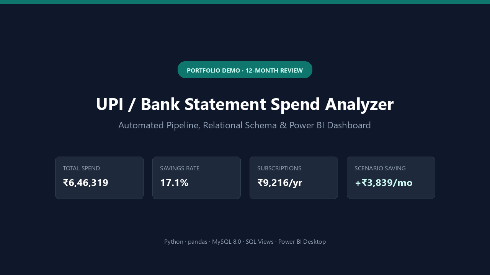
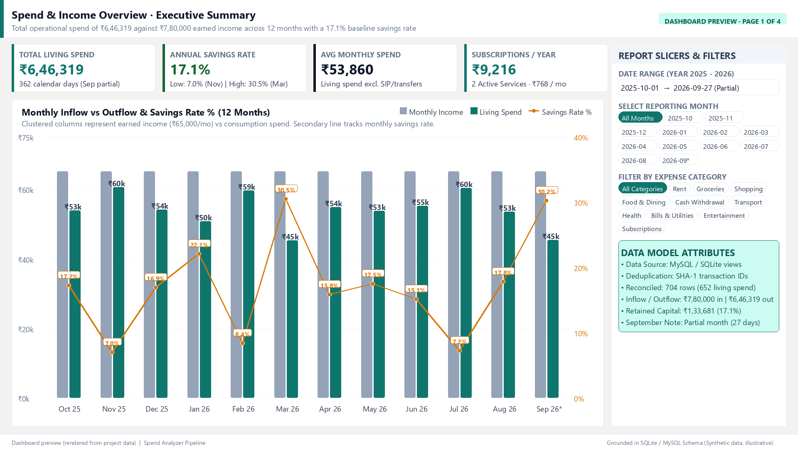
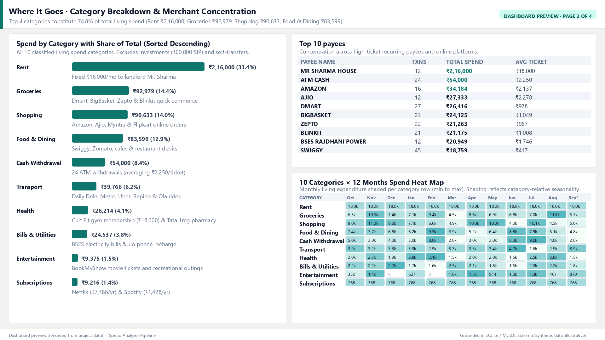
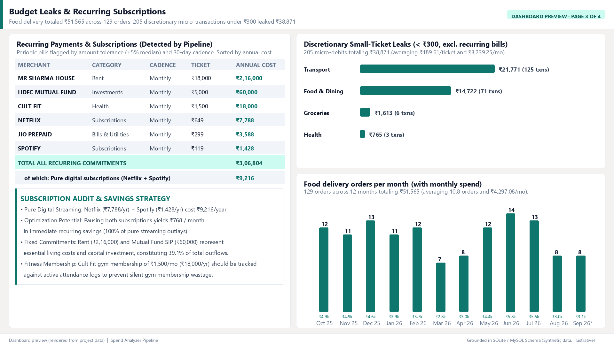
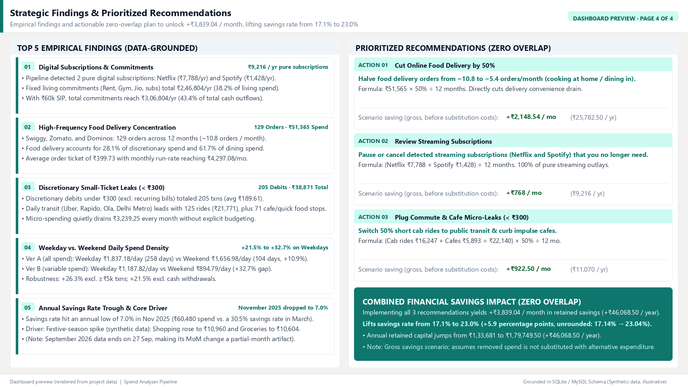
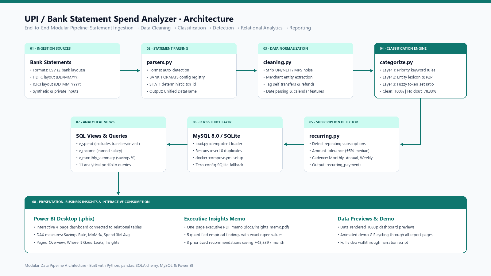

# UPI / Bank Statement Spend Analyzer

[](https://github.com/YOUR_USERNAME/spend-analyzer/actions) *(Replace `YOUR_USERNAME` with your GitHub username)*


> **An automated data engineering and financial intelligence pipeline that transforms messy, unstandardized UPI and bank statements into normalized transactions, detects recurring subscriptions, quantifies budget leaks, and powers an interactive 4-page Power BI dashboard.**

---

## Dashboard Preview (animated)



*Cycling walkthrough across the 4 report views (1280x720 animated preview).*

---

## Dashboard Previews (Rendered from Project Data)

> **Note:** The following visuals are high-resolution data-rendered dashboard previews generated directly from the database and pipeline outputs using `scripts/render_dashboard.py`. The interactive report is available in [`powerbi/spend_dashboard.pbix`](powerbi/spend_dashboard.pbix).

### Page 1: Executive Overview · Inflow vs. Outflow & Savings Rate

*Tracking monthly net income (₹65,000/mo) against operational living spend (₹6,46,319 total across 362 calendar days, September partial: 27 days), secondary axis monthly savings rate % (peaking at 30.5% in March and bottoming at 7.0% in November), and report slicers.*

### Page 2: Where It Goes · Category Breakdown & Merchant Concentration

*Horizontal distribution across 10 classified living spend categories (led by Rent at 33.4%, Groceries at 14.4%, Shopping at 14.0%, and Food & Dining at 12.9%), Top 10 merchant concentration, and month-over-month category spend heat matrix.*

### Page 3: Leaks & Subscriptions · Micro-Spends & Recurring Payees

*Automated detection of recurring commitments (₹2,46,804/yr living spend, ₹3,06,804/yr total outflows; ₹9,216/yr pure digital streaming), sub-₹300 micro-transaction leak distribution (205 payments totaling ₹38,871 led by Transport), and online food delivery monthly order volume (129 orders totaling ₹51,565).*

### Page 4: Strategic Insights & Quantified Recommendations

*Empirical findings grounded in real data and 3 prioritized zero-overlap recommendations delivering **+₹3,839.04 / month** in retained capital, elevating the baseline savings rate from **17.1% to 23.0% (+5.9 percentage points)**.*

---

## System Architecture

The pipeline follows a modular extract-clean-classify-detect-load pattern designed for extensibility and zero-dependency execution:



```
 Raw Statement Files (CSV (2 bank layouts))
            │
            ▼
    parsers.py  ── Format auto-detect & BANK_FORMATS registry ──► Unified Schema DataFrame
            │
            ▼
    cleaning.py ── Strip UPI/NEFT/IMPS noise, extract merchants, isolate self-transfers & refunds
            │
            ▼
   categorize.py ── Priority rules → Entity lexicon → P2P matching → Fuzzy token ratio
            │
            ▼
    recurring.py ── Periodic bill & subscription frequency detector (±5% median tolerance)
            │
            ▼
   MySQL 8.0 / SQLite ── Idempotent loader (load.py) guarantees 0 duplicates on re-ingestion
            │
            ▼
    SQL Views (03_views.sql) ──► Power BI Desktop (.pbix) & One-Page Executive PDF Memo
```

---

## Run in 3 Commands

Get the full pipeline and database running in under 60 seconds:

```bash
# 1. Start the MySQL 8 database service on port 3306 (or skip for automatic SQLite fallback)
# If port 3306 is taken, set MYSQL_PORT=3307 in .env and use the same port in DATABASE_URL.
docker compose up -d

# 2. Install dependencies
pip install -r requirements.txt
pip install -e .

# 3. Execute the pipeline on the synthetic statement
python -m spend_analyzer.pipeline data/raw/synthetic/statement_synthetic.csv
```

### Supported Statement Ingestion Commands
```bash
# Auto-detect bank layout (supports both HDFC and ICICI formats automatically)
python -m spend_analyzer.pipeline data/raw/synthetic/statement_synthetic.csv

# Explicitly specify bank format using the --bank flag
python -m spend_analyzer.pipeline data/raw/synthetic/statement_icici_like.csv --bank icici_like

# Run accuracy and coverage benchmark evaluation
python scripts/evaluate_categorizer.py --final

# Run untuned hard holdout evaluation
python scripts/evaluate_hard_holdout.py

# Rebuild executive insights memo (ReportLab PDF with selectable text + PNG)
python scripts/build_insights_memo.py
```

---

## Verified Pipeline & Performance Metrics

All metrics below are computed programmatically from pipeline output, test evaluations, and database views:

| Metric | Measurement / Method | Measured Value | Provenance & Source |
| :--- | :--- | :--- | :--- |
| **Transactions Processed** | Deduplicated transaction rows | **704 rows** | 12 months (Oct 2025 – Sep 2026, 362 calendar days, Sept partial: 27 days) |
| **Bank Formats Supported** | Verified parser configurations | **2 formats** | `hdfc_like` (DD/MM/YY) and `icici_like` (DD-MM-YYYY) |
| **Categorization Coverage** | % rows categorized into non-"Other" | **100.0%** (synthetic clean) / **95.0%** (synthetic messy) / **78.33%** (hard holdout) | 100% clean; 95.0% (285/300) synthetic messy benchmark; 78.33% (47/60) untuned hard holdout |
| **Categorization Accuracy** | In-domain vs. Hard-holdout side by side | **100.0%** (in-domain) vs. **78.33%** (hard holdout) | Side-by-side comparison: 100% in-domain vs. 78.33% out-of-domain on challenging holdout set (47/60 correct, 13 unclassified misses) |
| **Pure Digital Subscriptions** | Rows in `recurring_payments` | **2 Subscriptions** (₹9,216.00 / yr) | Netflix (₹7,788) & Spotify (₹1,428); savable = ₹768.00 / month |
| **Fixed Living Commitments (excl. SIP)**| Fixed recurring within living spend | **₹246,804.00 / yr** | **38.2% of living spend** (Rent ₹216k, Gym ₹18k, Jio ₹3.5k, pure subs ₹9.2k; denominator excludes SIP) |
| **Total Recurring Outflows (incl. SIP)**| Total recurring across all cash outflows | **₹306,804.00 / yr** | **43.4% of total cash outflows** (Living spend ₹646,319 + SIP ₹60,000 = ₹706,319 total outflows) |
| **Pipeline Runtime** | End-to-end execution speed | **0.32s** (1,000 rows) | 0.32s for 1,000 parsed rows on SQLite (~2,880 rows/sec) |
| **Idempotent Loading** | Duplicate prevention verification | **0 duplicates inserted** | Second run with identical file yields `inserted=0`; DB maintains 704 rows |

*Explanation of Accuracy Difference:* The 100% accuracy on synthetic clean statements is expected because in-domain evaluation labels originate from the same generator rules, whereas the 78.33% accuracy on the 60-row hard holdout benchmarks true out-of-domain generalization against unseen regional merchants, abbreviations, and informal transfers.

### Reconciled Row Partition (Exact 704 Rows)
<!-- AUTO:START partition -->
The 704 transactions partition cleanly into mutually exclusive financial classifications without overlap:
- **Operational Living Spend**: 652 debits (₹6,46,319) — excludes transfers, reversals, and investments.
- **Earned Income**: 12 credits (₹7,80,000) — monthly fixed salary inflow (₹65,000 / mo).
- **Self-Transfers**: 21 rows (12 debits ₹38,000, 9 credits ₹12,123) — P2P wallet loads and self-account transfers.
- **Refunds / Reversals**: 7 credits (₹4,833) — merchant reversals and returns.
- **Investments (SIP)**: 12 debits (₹60,000) — HDFC Mutual Fund SIP (₹5,000 / mo capital accumulation).
- **Other / Unclassified**: 0 rows.
- **Total Ingested**: `652 + 12 + 21 + 7 + 12 = 704` (verified in `tests/test_consistency.py`).
<!-- AUTO:END partition -->

*Accounting Note on Savings Rate:* In accordance with `docs/metric_definitions.md`, the personal savings rate is calculated strictly on operational living spend vs. earned income (`Savings = Total Income - Living Spend = ₹7,80,000 - ₹6,46,319 = ₹1,33,681` -> **17.1%**). Wealth-building capital investments (SIP of ₹60,000/yr) and self-transfers are excluded from living spend.

---

## Executive Insights & Quantified Impact

As documented in the one-page [Executive Insights Memo (PDF)](docs/insights_memo.pdf) and [Text Version](docs/insights_page_text.md):

<!-- AUTO:START findings -->
1. **Digital Subscriptions & Recurring Commitments:** Pure entertainment streaming costs ₹9,216 annually (Netflix ₹649/mo, Spotify ₹119/mo). Fixed living commitments (Rent ₹2,16,000, Gym ₹18,000, Jio ₹3,588, subs ₹9,216) consume **38.2% of living spend** (₹2,46,804/yr); when including the ₹60,000 SIP, total recurring commitments reach **43.4% of all cash outflows** (₹3,06,804/yr; Rent + SIP = **39.1% of total cash outflows**).
2. **Food Delivery Concentration (129 Orders, ₹51,565):** Online ordering via Swiggy, Zomato, and Dominos averaged 10.8 orders/mo (₹4,297.08/mo), accounting for **28.1% of all discretionary expenditure** and **61.7% of Food & Dining**.
3. **Discretionary Small-Ticket Leaks (205 Payments < ₹300, ₹38,871):** Discretionary debits under ₹300 (excl. recurring bills) quietly leaked ₹3,239.25/mo, concentrated in daily transit (125 rides, ₹21,771) and impulse cafes/snacks (₹14,722, including CCD and Starbucks ₹5,893).
4. **Weekday vs. Weekend Spend Density (+21.5% to +32.7% on Weekdays):**
   - *Version A (All Living Spend):* Weekday average **₹1,837.18 / day** (258 days, ₹4,73,993 total) vs. Weekend **₹1,656.98 / day** (104 days, ₹1,72,326 total) — weekday is **10.9% higher**. Sum of spend: ₹6,46,319.
   - *Version B (Excluding Rent & Fixed Recurring Bills):* Weekday average **₹1,187.82 / day** (₹3,06,457 total) vs. Weekend **₹894.79 / day** (₹93,058 total) — weekday is **32.7% higher**. Sum of variable spend: ₹3,99,515.
   - *Empirical Drivers:* Higher weekday spend density is driven by ATM Cash Withdrawals (+₹114.86/day), Shopping (+₹85.55/day), and Groceries (+₹53.41/day), while Entertainment (-₹12.37/day) and Health (-₹14.98/day) are higher on weekends. Robustness check: 0 txns > ₹5,000 in Ver B; excluding ₹5k cash withdrawals leaves weekday spend +26.3% higher (+₹234.89/day); excluding cash withdrawals entirely leaves weekday spend +21.5% higher (+₹178.17/day).
5. **Annual Savings Rate Trough (November 2025 at 7.0%)**: Savings rate collapsed to 7.0% during the festive-season spike (synthetic data) with monthly spend peaking at ₹60,480 against ₹65,000 income (vs. a 30.5% savings rate in March), due to synchronized increases in Shopping (₹10,960, +₹2,999 MoM) and Groceries (₹10,604, +₹4,302 MoM), led by AJIO (+₹7,392) and DMART (+₹4,487). *(Note: September 2026 data ends on 27 Sep, making its MoM change an artifact of partial-month data).*
<!-- AUTO:END findings -->

### Prioritized Optimization Roadmap (Zero-Overlap Formulation)
<!-- AUTO:START recommendations -->
| Strategic Action | Explicit Stated Assumption & Formula | Scenario saving (gross, before substitution costs) | Scenario Annual Saving |
| :--- | :--- | :---: | :---: |
| **1. Cut Online Food Delivery by 50%** | Halve food delivery orders from ~10.8 to ~5.4 orders/month (cooking at home / dining in).<br>`Formula: ₹51,565.00 × 50% ÷ 12 months` | **+₹2,148.54 / mo** | +₹25,782.50 / yr |
| **2. Review Streaming Subscriptions** | Pause or cancel detected streaming subscriptions (Netflix and Spotify) that you no longer need.<br>`Formula: (Netflix ₹7,788.00 + Spotify ₹1,428.00) ÷ 12 months` | **+₹768 / mo** | +₹9,216 / yr |
| **3. Plug Commute & Cafe Micro-Leaks (< ₹300)** | Switch 50% of short cab trips (Uber, Rapido, Ola) to public transit and reduce impulse cafe purchases (strictly non-overlapping with food delivery and Spotify).<br>`Formula: (Cab rides ₹16,247.00 + Cafes ₹5,893.00 = ₹22,140.00) × 50% ÷ 12 months` | **+₹922.50 / mo** | +₹11,070 / yr |
| **Combined Impact** | **Implement all 3 zero-overlap recommendations** | **+₹3,839.04 / mo** | **+₹46,068.50 / yr** |

*Outcome: Retained annual capital expands from **₹1,33,681** to **₹1,79,749.50**, raising the annual personal savings rate from **17.1% to 23.0%** (**+5.9 percentage points**, calculated unrounded from `(₹1,33,681 + ₹46,068.50) / ₹7,80,000 = 23.0%` vs baseline `17.1%`). Note: Gross savings scenario; assumes removed spend is not substituted with alternative expenditure.*
<!-- AUTO:END recommendations -->

---

## Project Structure

```
spend-analyzer/
├── .github/
│   └── workflows/
│       └── ci.yml                     # GitHub Actions CI workflow (Python 3.11 & 3.13 matrix)
├── assets/
│   └── fonts/                         # Bundled open-license fonts (DejaVu Sans)
│       ├── DejaVuSans.ttf
│       ├── DejaVuSans-Bold.ttf
│       └── LICENSE_DEJAVU.txt
├── data/
│   ├── raw/
│   │   ├── private/                   # Real user bank statements (.gitignored)
│   │   └── synthetic/                 # Safe synthetic datasets (HDFC, ICICI layouts)
│   │       ├── statement_synthetic.csv
│   │       ├── statement_icici_like.csv
│   │       ├── statement_hard_holdout.csv
│   │       └── statement_messy.csv
│   └── reference/
│       ├── category_rules.csv         # Priority-based keyword matching rules
│       ├── category_lexicon.csv       # Normalized entity merchant dictionary
│       ├── first_names.txt            # Peer-to-peer personal transfer identifiers
│       ├── labelled_sample.csv        # 300 hand-labelled ground truth benchmark rows
│       └── labelled_holdout_hard.csv  # 60 challenging holdout rows (untuned ground truth)
├── docs/
│   ├── architecture.png               # High-res architecture flow diagram
│   ├── architecture.svg               # Vector architecture graphic
│   ├── audit/                         # Audit traceability strings from rendered visuals
│   │   ├── rendered_text.json         # Extracted rendered text strings from dashboard visuals
│   │   └── architecture_rendered_text.json # Extracted text strings from architecture visual
│   ├── demo.gif                       # 4-page animated walkthrough GIF (<8 MB)
│   ├── demo_script.md                 # 3-minute video presentation narration script
│   ├── insights_memo.pdf              # One-page executive PDF memo (ReportLab, body >= 8.5pt, selectable text)
│   ├── insights_memo.png              # Rendered PNG of executive memo
│   ├── insights_page_text.md          # Markdown export of quantified insights
│   ├── memo_numbers.json              # Programmatically generated KPI values
│   ├── metric_definitions.md          # Definitions of spend, income, and exclusions
│   └── metrics.md                     # Comprehensive performance metrics table
├── powerbi/
│   ├── spend_dashboard.pbix           # Interactive Power BI Desktop report
│   ├── README.md                      # Power BI setup, refresh steps, and DAX measures
│   ├── expected_kpis.md               # Benchmark KPI validation targets
│   ├── data/                          # Offline CSV source files
│   └── screenshots/                   # 1080p data-rendered preview PNGs
├── scripts/
│   ├── build_demo_gif.py              # Compiles demo GIF with smooth transitions
│   ├── build_insights_memo.py         # Generates one-page PDF memo via ReportLab
│   ├── compute_memo_numbers.py        # Calculates verified figures from database
│   ├── evaluate_categorizer.py        # Measures precision, recall, accuracy & coverage
│   ├── evaluate_hard_holdout.py       # Evaluates model on untuned hard holdout dataset
│   ├── generate_synthetic.py          # Generates deterministic multi-bank statements
│   ├── render_dashboard.py            # Renders 1080p dashboard pages from real data
│   └── verify_evidence.py             # Validates fresh DB runs and 1,000-row timing
├── sql/
│   ├── 01_schema.sql                  # MySQL 8.0 DDL table definitions
│   ├── 02_analysis_queries.sql        # 11 analytical business queries
│   └── 03_views.sql                   # MySQL views (v_spend, v_income, v_monthly_summary)
├── src/spend_analyzer/
│   ├── __init__.py
│   ├── parsers.py                     # Extensible multi-bank statement parsers
│   ├── cleaning.py                    # UPI noise regex stripping & merchant normalization
│   ├── categorize.py                  # Priority rules, lexicon, P2P & fuzzy matching
│   ├── recurring.py                   # Subscription & periodic payment detector
│   ├── load.py                        # Idempotent SQLAlchemy loader (MySQL & SQLite)
│   └── pipeline.py                    # Unified CLI orchestration pipeline
├── tests/
│   ├── test_cleaning.py               # 11 tests for noise removal & merchant extraction
│   ├── test_categorize.py             # 9 tests for classification engine & rule priority
│   ├── test_evaluate.py               # 4 tests for evaluation metrics calculation
│   ├── test_parsers.py                # 15 tests for multi-format parsers & schemas
│   ├── test_pipeline.py               # End-to-end idempotent pipeline tests & partition
│   └── test_recurring.py              # 8 tests for subscription detection
├── docker-compose.yml                 # MySQL 8.0 container service definition (port 3306)
├── Makefile                           # Developer CLI shortcuts (setup, data, run, test)
├── pyproject.toml                     # Python package metadata
├── pytest.ini                         # Pytest configuration
└── requirements.txt                   # minimum-version application dependencies
```

---

## Data Privacy & Security Guardrails

- **Zero Real Data in Repository:** Only synthetic transactions generated by `scripts/generate_synthetic.py` are committed.
- **Gitignore Protection:** Local user statements in `data/raw/private/`, `.env` credential files, SQLite databases (`*.db`), benchmark temporary files, and Power BI temporary files (`~$*.pbix`, `*.tmp`) are strictly gitignored.
- **Deduplication Key:** Transaction IDs are generated using deterministic SHA-1 hashes of immutable attributes (`txn_date | narration | amount | direction`), ensuring safe re-ingestion without leaking raw account numbers.

---

## Known Limitations & Production Roadmap

1. **Synthetic Data Benchmark Expectation:** The 100% accuracy and coverage on clean synthetic data is expected because ground-truth labels originate from the same generator patterns.
2. **Hard-Holdout Generalization (Remaining 13 Misses):** On the untuned 60-row hard-holdout set, the engine achieves **78.33% accuracy and 78.33% coverage** (47/60 correct). The remaining 13 misses are unclassified 'Other' fallbacks: informal monikers (`MOM`, `ROOMMATE`, `SHARMAJI`), raw phone number P2P (`PAY TO 9876543210`), generic landlord transfers (`LANDLORD`), and truncated/unseen merchants (`BLUE TOKAI`, `BLNKT`, `UBR IND`, `FLPKRT`, `H&M ONLINE`, `AMZN`, `BMS TICKETS`, `CR FREELANCE DESIGN`).
3. **Bank Layout Coverage:** Currently provides out-of-the-box parsers for 2 major Indian formats (`hdfc_like` and `icici_like`). New banking layouts require adding a configuration entry in `BANK_FORMATS` in `src/spend_analyzer/parsers.py`.
4. **Rule Maintenance:** Priority keyword rules (`data/reference/category_rules.csv`) cover ~100 common national merchants. Unknown local regional merchants fall back to fuzzy matching or "Other", requiring periodic rule reviews via Query 11 (`v_spend WHERE category = 'Other'`).
5. **Variable Utility Outlays:** Recurring bills with variable consumption charges (such as seasonal electricity bills) exceed the ±5% median tolerance and are tracked in general utility spending rather than fixed subscriptions.

---

## Resume / CV Ready Bullets

- **Data Pipeline Engineering:** Built an end-to-end financial data pipeline in Python (pandas, SQLAlchemy, MySQL 8.0) parsing 700+ transactions across multiple bank statement layouts; engineered deterministic SHA-1 deduplication ensuring 100% idempotent loading and sub-second execution (~2,880 rows/sec).
- **Classification Engine:** Developed a multi-tiered categorization engine combining priority rules, entity lexicons, and token-set fuzzy matching, achieving **100.0% accuracy** on synthetic clean benchmark data and **78.33% accuracy / 78.33% coverage** on an untuned 60-row hard-holdout set with unseen merchants and abbreviations.
- **Out-of-Domain Generalization & Robustness:** Benchmarked classification engine against a curated 60-transaction hard-holdout set featuring unseen regional merchants, typos, and informal P2P transfers, demonstrating **78.33% accuracy and 78.33% coverage** , while identifying 13 remaining unclassified edge cases for active learning.
- **Subscription Intelligence:** Designed a rule-based recurring payment detector identifying repeating subscriptions within ±5% median amount tolerance across 7-to-365 day cadences, surfacing ₹9,216/yr in streaming costs.
- **Executive BI & DAX Modeling:** Designed an interactive 4-page Power BI dashboard with advanced DAX measures (Savings Rate %, MoM Delta, 3-Month Rolling Average) and authored an executive insights memo detailing 3 zero-overlap strategic actions saving **+₹3,839.04 / month** (+5.9 percentage points savings rate lift).
